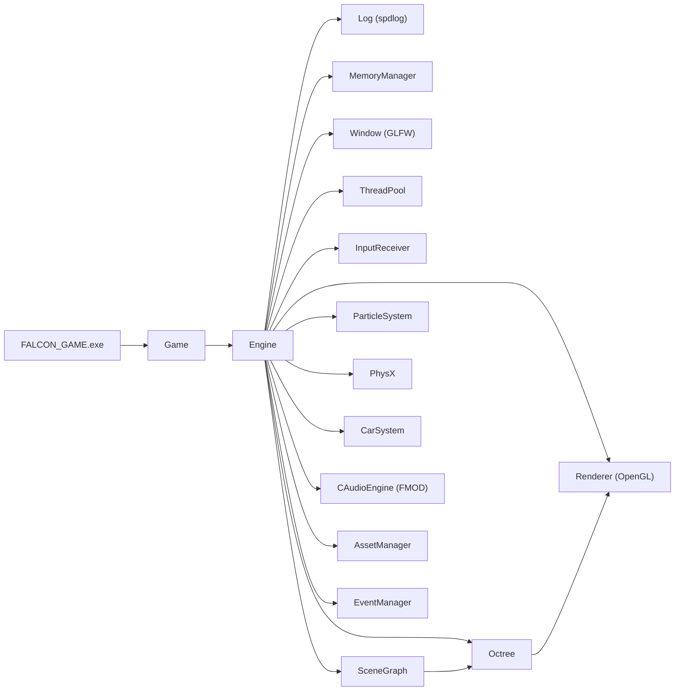
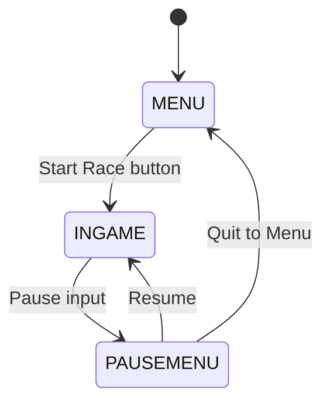

# Architecture

This document describes the two-project structure of Falcon Engine, the game state machine, initialization and shutdown sequences, per-frame data flow, and all major subsystems.

---

## Table of Contents

- [Project Layout](#project-layout)
- [High-Level Dependency Graph](#high-level-dependency-graph)
- [Game State Machine](#game-state-machine)
- [Initialization Sequence](#initialization-sequence)
- [Per-Frame Data Flow](#per-frame-data-flow)
- [Shutdown Sequence](#shutdown-sequence)
- [Subsystems at a Glance](#subsystems-at-a-glance)
- [Component Types](#component-types)
- [Event System](#event-system)
- [Memory Management](#memory-management)

---

## Project Layout

The solution compiles to two artifacts with a clean engine / game separation:

| Project | Output | Role |
|---|---|---|
| `Falcon` | `Falcon.lib` | Static engine library — all subsystems |
| `FALCON_GAME` | `FALCON_GAME.exe` | Game executable — consumes the engine |

`FALCON_GAME` owns the entry point, the game state machine, and UI page setup.  
`Falcon.lib` owns every engine subsystem; none depend on game code.

---

## High-Level Dependency Graph



---

## Game State Machine

`Game::Run()` drives a `while (!windowClose)` loop. The active `STATE` enum value controls which update path executes each frame.



Each state has a one-shot `_Init()` and a per-frame `_Update()` in `Game`, paired with the corresponding `Engine` method:

| State | Game side | Engine side |
|---|---|---|
| `MENU` | `Menu_Init()` / `Menu_Update()` | `Engine::MenuUpdate()` |
| `INGAME` | `Game_Init()` / `Game_Update()` | `Engine::IngameUpdate()` |
| `PAUSEMENU` | `PauseMenu_Init()` / `PauseMenu_Update()` | `Engine::PauseUpdate()` |

The transition from `MENU` to `INGAME` is triggered by a `boost::function` callback wired to the Start Race button during `Menu_Init()`.

---

## Initialization Sequence

`Engine::Initialize()` runs once on startup in this exact order:

1. `Log::Init()` — spdlog engine + client loggers online
2. `fmemory::MemoryManagerInit()` — custom allocator must be first
3. `WindowClass` — GLFW window created at 1280 × 720
4. `ThreadPool::GetThreadPool()` — worker threads started
5. `InputReceiver::Init()` — GLFW input callbacks registered
6. `physics::InitPhysX()` — NVIDIA PhysX SDK foundation + scene
7. `CarSystem::Initialize()` — vehicle simulation ready
8. `Renderer::Init()` — OpenGL context, shaders, render passes
9. `Timer` — delta-time tracking starts
10. `SceneGraph` — deserializes `../Assets/Scenes/scene.json`
11. `ParticleSystem` — GPU particle pipeline created
12. `Octree` — built from scene geometry; projection matrix set
13. `Renderer::CreateDrawStates` / `SetDrawStates` — viewable set prepared
14. `CAudioEngine::Init()` + `LoadSound()` + `PlaySounds()` — FMOD Studio live

> **Important:** The memory manager must be initialized before any `fnew<>` call and shut down last. Reordering steps 2 or 14 will crash or silence audio.

---

## Per-Frame Data Flow

The sequence below runs every frame while in `STATE::INGAME`:

```
Timer::update() ──► dt
    │
    ├─ SceneGraph::UpdateScene()              entity transform hierarchy updated
    │
    ├─ Octree::SetView(CameraSystem::GetView())
    │   └─ Octree::Update()                  frustum cull → viewable set rebuilt
    │
    ├─ ParticleSystem::Update(dt, entities)
    │
    ├─ Renderer::Ingame_Update(dt, entities)
    │   └─ Renderer::Ingame_Draw()           OpenGL draw calls submitted
    │
    ├─ physics::StepPhysics(dt, entities)    PhysX simulation step
    │
    ├─ InputReceiver::Update()               GLFW input queue processed
    │
    ├─ CarSystem::Update()                   vehicle state advanced
    │
    └─ CAudioEngine::Update()                FMOD Studio frame tick (required)
```

In `STATE::MENU` and `STATE::PAUSEMENU`, only `Renderer`, `Input`, and `CAudioEngine` update. Physics, scene, and particle systems are paused.

---

## Shutdown Sequence

`Engine::~Engine()` tears down in reverse dependency order:

1. `fdelete`: `m_scene`, `m_octree`, `m_timer`, `m_particleSystem`, `m_renderer`, `m_input`, `m_window`
2. `AssetManager::Clean()`
3. `CarSystem::ShutDown()`
4. `physics::ShutdownPhysX()`
5. `ThreadPool::ShutDown()`
6. `fmemory::MemoryManagerShutDown()` — allocator offline
7. `CAudioEngine::UnLoadSound()` + `Shutdown()` — FMOD last

Audio is shut down after the memory manager so that subsystems can still emit sounds during their teardown if needed.

---

## Subsystems at a Glance

| Subsystem | Source folder | Lifetime pattern | Notes |
|---|---|---|---|
| `Engine` | `Falcon/System/` | Owned by `Game` | Central orchestrator |
| `Renderer` | `Falcon/Rendering/` | `fnew` / `fdelete` | OpenGL; multi-pass pipeline |
| `SceneGraph` | `Falcon/Core/Scene/` | `fnew` / `fdelete` | JSON scene deserialization |
| `Octree` | `Falcon/Rendering/PipeLine/` | `fnew` / `fdelete` | Frustum culling |
| `ParticleSystem` | `Falcon/Rendering/` | `fnew` / `fdelete` | GPU particles |
| `PhysX` | `Falcon/Physics/` | Free functions | `physics::` namespace |
| `CarSystem` | `Falcon/Physics/vehicle/` | Static methods | NVIDIA Vehicle SDK wrapper |
| `CAudioEngine` | `Falcon/Audio/` | Value member of `Engine` | FMOD Studio — PIMPL |
| `AssetManager` | `Falcon/Core/` | Static methods | Assimp, rapidjson, DDS, Nuklear |
| `EventManager` | `Falcon/Core/Events/` | Static methods | Typed `boost::shared_ptr` bus |
| `ThreadPool` | `Falcon/System/` | Singleton | `boost::thread` workers |
| `Log` | `Falcon/System/` | Static (spdlog) | Engine + client loggers |
| `InputReceiver` | `Falcon/System/` | `fnew` / `fdelete` | GLFW callbacks → state |
| `CameraSystem` | `Falcon/Rendering/` | Static methods | View matrix provider |

---

## Component Types

Entities in the `SceneGraph` carry components defined in `Falcon/Core/Components/`. All inherit from `BasicComponent`.

| Component | Purpose |
|---|---|
| `TransformComponent` | World position, rotation, scale |
| `RenderComponent` | Mesh + material reference |
| `PhysicsComponent` | Wraps `PxRigidActor` / `PxShape` |
| `AudioComponent` | Per-entity sound attachment |
| `InputComponent` | Maps input events to entity actions |
| `AnimationComponent` | Skeletal animation state (ozz-animation) |
| `AIComponent` | AI behaviour hooks |
| `ParticleEmitterComponent` | Particle burst / stream configuration |
| `BasicComponent` | Base class; general-purpose tag / data bag |

---

## Event System

Events flow through `EventManager` using a typed category bus. Producers push `boost::shared_ptr<Event>` objects tagged with a category; consumers subscribe per category.

Key event types defined in `Falcon/Core/Events/`:

| Event type | Category | Purpose |
|---|---|---|
| `RenderEvent` | Render | Triggers a render pass |
| `PassToRenderer` | Render | Submits a batch to the renderer |
| `PassingMeshEvent` | Render | Single mesh submission |
| `ParticleEvent` | Particle | Spawns a particle effect |
| `KeyEvents` | Input | Keyboard / mouse notifications |

---

## Memory Management

All engine heap allocations use `fmemory::fnew<T>()` and `fmemory::fdelete()` rather than `new` / `delete`. This routes all allocations through the custom memory manager, enabling leak tracking and pool allocation.

**Rules:**
- `fmemory::MemoryManagerInit()` must be the first system initialized.
- `fmemory::MemoryManagerShutDown()` must be the last system shut down.
- Never mix `fnew` / `fdelete` with `new` / `delete` on the same object.
- `AssetManager`, `EventManager`, `ThreadPool`, `Log`, and `CameraSystem` use static storage and are not allocated through `fmemory`.