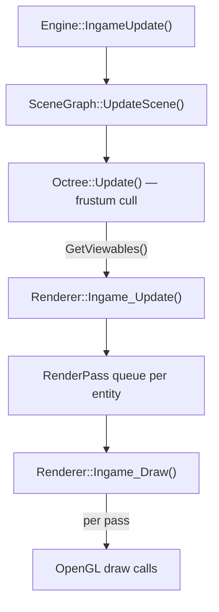

# Rendering

The rendering subsystem is OpenGL 4.x, split across `Renderer`, `RenderPass`, `Octree`, `CameraSystem`, `ParticleSystem`, and a PBR material pipeline backed by GLM and GLAD.

---

## Table of Contents

- [Overview](#overview)
- [Renderer](#renderer)
- [Render Pass System](#render-pass-system)
- [Per-Frame Pipeline](#per-frame-pipeline)
- [Material System](#material-system)
- [Mesh and Buffer Layout](#mesh-and-buffer-layout)
- [Octree and Frustum Culling](#octree-and-frustum-culling)
- [Camera and CameraSystem](#camera-and-camerasystem)
- [Particle System](#particle-system)
- [RenderEventSystem](#rendereventsystem)

---

## Overview



The `Renderer` owns three vectors of `RenderPass*` — one per game state — and dispatches into the correct vector each frame.

---

## Renderer

**Header:** `Falcon/Rendering/PipeLine/Renderer.h`

```cpp
class Renderer {
    RenderEventSystem* m_RES;
    UI::UI_Manager*    m_UI;
    GLFWwindow*        m_window;
    glm::mat4          m_projection;

    boost::container::vector<RenderPass*> m_Game_renderPasses;
    boost::container::vector<RenderPass*> m_Menu_renderPasses;
    boost::container::vector<RenderPass*> m_Pause_renderPasses;

    boost::container::vector<Entity*>* m_entities;
    Mesh*    m_terrainMesh;
    Mesh*    m_skyMesh;
    Texture  m_brdfTexture;
    Waypoint wp;

public:
    void Init(GLFWwindow* window);
    void CreateDrawStates(GLFWwindow* win);
    void SetDrawStates(boost::container::vector<Entity*>* entities, glm::mat4 projection);

    void Ingame_Update(float dt, boost::container::vector<Entity*>* entities);
    void Ingame_Draw();

    void Menu_Update();
    void Menu_Draw();

    void Pause_Update();
    void Pause_Draw();

    UI::UI_Manager* GetUI();
};
```

### Lifecycle

| Method | When called | What it does |
|---|---|---|
| `Init(window)` | `Engine::Initialize()` | OpenGL context setup, shaders, IBL textures |
| `CreateDrawStates(win)` | After scene load | Instantiates all `RenderPass` objects |
| `SetDrawStates(entities, proj)` | After octree built | Assigns the viewable entity set and projection matrix |
| `Ingame_Update(dt, entities)` | Every INGAME frame | Updates transforms, queues renderables into passes |
| `Ingame_Draw()` | Every INGAME frame | Iterates `m_Game_renderPasses`, calls `Render()` on each |
| `Menu_Update/Draw()` | Every MENU frame | Runs UI canvas pipeline |
| `Pause_Update/Draw()` | Every PAUSEMENU frame | Runs pause overlay pipeline |

The `Renderer` also owns the **terrain mesh** and **sky mesh** directly, as these are static assets shared across render passes via `RenderEventSystem`.

---

## Render Pass System

**Header:** `Falcon/Rendering/PipeLine/RenderPasses/RenderPass.h`

```cpp
class RenderPass {
    bool     m_depthMask       = false;
    uint32_t m_cullFace        = GL_BACK;
    uint32_t m_blendEquation   = GL_FUNC_ADD;
    uint32_t m_srcBlendFunc    = GL_SRC_ALPHA;
    uint32_t m_dstBlendFunc    = GL_ONE_MINUS_SRC_ALPHA;
    uint32_t m_priority        = 0;

    boost::container::vector<uint32_t> m_enabledProperties;
    boost::container::vector<uint32_t> m_disabledProperties;

protected:
    boost::container::set<Renderable*> m_renderQueue;

public:
    RenderPass(uint32_t priority);
    virtual void QueueRenderable(Renderable* rend);
    virtual void Render();

    void SetDepthMask(bool isEnabled);
    void SetCullFace(uint32_t cullFace);
    void SetBlendEquation(uint32_t blendEq);
    void SetBlendFunctions(uint32_t srcFunc, uint32_t dstFunc);
    void AddEnabledProperty(uint32_t property);    // glEnable(property)
    void AddDisabledProperty(uint32_t property);   // glDisable(property)
};
```

`RenderPass` is a **polymorphic base**. Each concrete pass subclass overrides `Render()` to issue its specific OpenGL calls. The `m_renderQueue` is a priority-ordered set of `Renderable*` objects that were queued by `Ingame_Update()`.

**Configuring a pass:**

```cpp
pass->SetDepthMask(true);
pass->SetCullFace(GL_BACK);
pass->AddEnabledProperty(GL_DEPTH_TEST);
pass->AddDisabledProperty(GL_BLEND);
```

The `Renderer` populates all three pass vectors (`m_Game_renderPasses`, `m_Menu_renderPasses`, `m_Pause_renderPasses`) during `CreateDrawStates()`, with each entry constructed at a distinct priority level.

---

## Per-Frame Pipeline

Every `INGAME` frame follows this exact sequence:

```
1. CameraSystem::Update(dt)
       └─ updates m_mainCam view matrix

2. Renderer::Ingame_Update(dt, entities)
       ├─ iterates entities from Octree viewable set
       ├─ calls pass->QueueRenderable() for each visible entity
       └─ updates world/normal matrices on instanced meshes

3. Renderer::Ingame_Draw()
       └─ for each RenderPass in m_Game_renderPasses (by priority):
              ├─ apply GL state (depth, blend, cull, enabled/disabled flags)
              └─ pass->Render()
                     └─ for each Renderable in m_renderQueue:
                            ├─ material->Bind()   — textures + uniforms
                            ├─ mesh->Bind()        — VAO + buffers
                            └─ glDrawElementsInstanced(...)
```

---

## Material System

**Header:** `Falcon/Rendering/PipeLine/Material.h`

Falcon uses a **PBR (physically based rendering)** material model with five texture channels and scalar fallbacks for each:

| Channel | Texture field | Scalar fallback | Default |
|---|---|---|---|
| Albedo | `m_albedoTex` | `m_albedo` (`glm::vec3`) | `(1,1,1)` |
| Roughness | `m_roughnessTex` | `m_roughness` (`float`) | `1.0` |
| Normal | `m_normalTex` | `m_normal` (`glm::vec3`) | `(0.5,0.5,1)` |
| Metallic | `m_metallicTex` | `m_metallic` (`float`) | `0.0` |
| Ambient Occlusion | `m_aoTex` | `m_ao` (`float`) | `0.0` |

Each material also holds a `Shader*` pointer. Calling `Bind()` uploads all texture units and scalar uniforms to the shader in a single call.

**Usage pattern:**

```cpp
material->SetShader(myShader);
material->Bind();            // uploads all PBR uniforms + textures
mesh->Bind();                // binds VAO
glDrawElementsInstanced(...);
```

Textures are loaded from DDS files via `AssetManager` (using `stb_dds`). JSON material descriptors store the five texture paths under each entity's `RenderComponent`.

---

## Mesh and Buffer Layout

**Header:** `Falcon/Rendering/PipeLine/Mesh.h`

`Mesh` extends `Renderable` and uses **three VBOs plus one IBO**:

```
VBO1 — vertex positions / normals / UVs / tangents
VBO2 — per-instance world matrices   (mat4 × instance count)
VBO3 — per-instance normal matrices  (mat3 × instance count)
IBO  — index buffer
```

Instanced rendering is the default path. Before each draw, `Ingame_Update()` calls:

```cpp
mesh->ClearWorldMatrices();
// for each visible entity that shares this mesh:
mesh->AddWorldAndNormalMatrix(worldMat, normalMat);
```

Then `Render()` issues a single `glDrawElementsInstanced()` covering all instances.

`GetVertexPositionsArray()` and `GetindicesArray()` are used by PhysX to build convex mesh colliders from the same geometry.

---

## Octree and Frustum Culling

**Header:** `Falcon/Rendering/PipeLine/Octree.h`

```cpp
class Octree {
    glm::vec3 m_nearTopLeft;      // (-320,  320, -320)
    glm::vec3 m_farBottomRight;   // ( 320, -320,  320)
    float     m_minSide;          // 5.0f
    glm::mat4 m_projection, m_view;
    planeArray m_planeArr;        // 6 frustum planes

    Scene::entityVector m_renderables;  // all scene entities
    Scene::entityVector m_viewables;    // frustum-visible subset

public:
    Octree(glm::vec3 nearTopLeft, glm::vec3 farBottomRight, float minSide, Scene::SceneGraph* scene);
    void SetProjection(glm::mat4 proj);
    void SetView(glm::mat4 view);
    void Update();
    Scene::entityVector* GetViewables();
};
```

**Construction** (`Engine::Initialize`):

```cpp
m_octree = fmemory::fnew<Octree>(
    glm::vec3(-320.0f, 320.0f, -320.0f),
    glm::vec3( 320.0f,-320.0f,  320.0f),
    5.0f,
    m_scene
);
m_octree->SetProjection(projection);
```

The world is partitioned into nodes with a minimum side length of **5.0 units**. Each entity is assigned to the smallest node that fully contains it.

**Per-frame update:**

```cpp
m_octree->SetView(CameraSystem::GetView());
m_octree->Update();
// m_octree->GetViewables() now holds only frustum-visible entities
```

`Update()` calls `GetPlanes()` to extract the six frustum planes from the combined VP matrix, then `CullObjects()` to walk the octree and populate `m_viewables`.

---

## Camera and CameraSystem

**Headers:** `Falcon/Rendering/Camera.h`, `Falcon/Rendering/CameraSystem.h`

### Camera (legacy)

A Euler-angle free camera used in `Engine.cpp` for setting up the initial projection matrix. Supports `ProcessKeyboard()`, `ProcessMouseMovement()`, and `ProcessMouseScroll()`. The instance in `Engine.cpp` is a local in `namespace gameLoop` and is not updated at runtime — it is a setup artifact.

### CameraSystem (active)

`CameraSystem` is a **static** system that manages `CameraComponent` entities from the scene:

```cpp
class CameraSystem {
    static CameraComponent* m_mainCam;
    static bool             m_cameraMoveable;
public:
    static void          Initialize();
    static void          ShutDown();
    static void          Update(float dt);
    static void          SetMainCam(unsigned int index);
    static glm::mat4     GetView();         // used by Octree + Renderer
    static glm::vec3     GetPos();
    static CameraComponent* GetMain();
    static bool          IsMoveable();
    static void          SetCamType(CameraType type);
};
```

`GetView()` is the authoritative view matrix for the frame. It is consumed by:

- `Octree::SetView()` — frustum culling
- Render pass shaders — via MVP uniform upload

Camera movement is gated by `m_cameraMoveable`, which can be toggled between cinematic and player-follow modes via `SetCamType()`.

---

## Particle System

**Header:** `Falcon/Rendering/ParticleSystem.h`

```cpp
class ParticleSystem {
    ParticleEventSystem* m_PES;
public:
    ParticleSystem();   // calls Init()
    void Init();
    void Update(float dt, boost::container::vector<Entity*>* entities);
};
```

`ParticleSystem` uses its own event system (`ParticleEventSystem`) to receive `ParticleEvent` instances dispatched by game code. On `Update()`, it iterates all entities that carry a `ParticleEmitterComponent` and advances their simulation state. Particle geometry is submitted directly to OpenGL — it does not go through the `RenderPass` queue.

---

## RenderEventSystem

`RenderEventSystem` is a **singleton** event system that handles render-category events (`RenderEvent`, `PassToRenderer`, `PassingMeshEvent`). It holds references to the shared terrain and sky meshes, making them available to render passes without needing a pointer back to `Renderer`.

```cpp
RenderEventSystem* res = RenderEventSystem::GetInstance();
res->SubscribeToEvents();   // called once during Renderer::Init()
// each frame:
res->ProcessEvents();       // drains the render event queue
```

`ShutDown()` must be called during `Renderer` teardown to release the singleton.