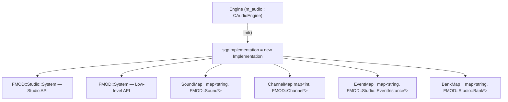

# Audio

The audio subsystem wraps **FMOD Studio** behind a PIMPL façade (`Implementation`) and exposes a flat static API through `CAudioEngine`. Both the low-level sound system and the Studio event system are available.

---

## Table of Contents

- [Architecture](#architecture)
- [Implementation Struct](#implementation-struct)
- [CAudioEngine API](#caudioengine-api)
- [Lifecycle](#lifecycle)
- [Loading and Playing Sounds](#loading-and-playing-sounds)
- [3D Audio](#3d-audio)
- [Channel Management](#channel-management)
- [FMOD Studio — Banks and Events](#fmod-studio--banks-and-events)
- [Volume Utilities](#volume-utilities)
- [Current Engine Usage](#current-engine-usage)
- [Known Pitfalls](#known-pitfalls)

---

## Architecture



`CAudioEngine` is a **static-only class** — all methods are `static` and operate on the global `sgpImplementation` pointer. The `CAudioEngine m_audio` value member in `Engine` exists solely to tie `Init()` and `Shutdown()` to a natural call site in the engine lifecycle.

---

## Implementation Struct

**Source:** `Falcon/Audio/AudioEngine.cpp`

```cpp
struct Implementation {
    FMOD::Studio::System*  mpStudioSystem;   // Studio high-level system
    FMOD::System*          mpSystem;         // Low-level core system

    int mnNextChannelId = 0;                 // auto-incrementing channel ID

    typedef map<string, FMOD::Sound*>                    SoundMap;
    typedef map<int,    FMOD::Channel*>                  ChannelMap;
    typedef map<string, FMOD::Studio::EventInstance*>    EventMap;
    typedef map<string, FMOD::Studio::Bank*>             BankMap;

    BankMap    mBanks;
    EventMap   mEvents;
    SoundMap   mSounds;
    ChannelMap mChannels;

    Implementation();
    ~Implementation();
    void Update();
};
```

**Constructor** — creates and initialises the Studio system:

```cpp
FMOD::Studio::System::create(&mpStudioSystem);
mpStudioSystem->initialize(
    32,                          // max channels
    FMOD_STUDIO_INIT_LIVEUPDATE, // enables FMOD Studio live profiling
    FMOD_INIT_PROFILE_ENABLE,
    NULL
);
mpStudioSystem->getCoreSystem(&mpSystem);  // low-level system handle
```

**Destructor** — calls `mpStudioSystem->unloadAll()` then `release()`.

**`Update()`** — scans `mChannels` for stopped channels, removes them from the map, then calls `mpStudioSystem->update()`. This is the FMOD frame tick and **must run every frame** or audio will stall.

---

## CAudioEngine API

**Header:** `Falcon/Audio/AudioEngine.h`

| Method | Returns | Description |
|---|---|---|
| `Init()` | `void` | Creates `Implementation`; must be called before all other methods |
| `Update()` | `void` | FMOD frame tick — call once per frame in every game state |
| `Shutdown()` | `void` | Destroys `Implementation`; call after `UnLoadSound()` |
| `ErrorCheck(result)` | `int` | Logs and returns FMOD error code; `0` = OK |
| `LoadSound(name, b3d, bLooping, bStream)` | `void` | Loads a sound file into `mSounds` |
| `UnLoadSound(name)` | `void` | Releases FMOD sound and removes from map |
| `PlaySounds(name, pos, volumedB)` | `int` | Plays a sound; returns channel ID |
| `SetChannel3dPosition(id, pos)` | `void` | Moves an active channel in 3D space |
| `SetChannelVolume(id, dB)` | `void` | Sets channel volume in dB |
| `LoadBank(name, flags)` | `void` | Loads an FMOD Studio bank file |
| `LoadEvent(name)` | `void` | Creates a Studio event instance |
| `PlayEvent(name)` | `void` | Starts a Studio event (auto-loads if needed) |
| `StopEvent(name, bImmediate)` | `void` | Stops a Studio event; fade-out or immediate |
| `IsEventPlaying(name)` | `bool` | Returns `true` if event is in PLAYING state |
| `dbToVolume(dB)` | `float` | Converts dB to FMOD linear volume |
| `VolumeTodB(volume)` | `float` | Converts FMOD linear volume to dB |
| `VectorToFmod(glm::vec3)` | `FMOD_VECTOR` | Converts GLM vector to FMOD 3D position |

---

## Lifecycle

Audio must be the **last system initialised** among non-memory systems. The exact sequence in `Engine` is:

**Startup** (`Engine::Initialize()` — step 14):

```cpp
m_audio.Init();
m_audio.LoadSound("../Assets/Sounds/f1_theme_brian_tyler.wav", true, true, false);
m_audio.PlaySounds("../Assets/Sounds/f1_theme_brian_tyler.wav", { 0, 0, 0 }, -0.6f);
```

**Per-frame** (all three `Engine::*Update()` methods):

```cpp
m_audio.Update();
```

**Shutdown** (`Engine::~Engine()` — after memory manager):

```cpp
m_audio.UnLoadSound("../Assets/Sounds/f1_theme_brian_tyler.wav");
m_audio.Shutdown();
```

> **Critical:** If `Update()` is missing from any game state, FMOD's internal scheduler stalls and all audio goes silent — even sounds that were already playing. See [Known Pitfalls](#known-pitfalls).

---

## Loading and Playing Sounds

`LoadSound()` constructs the `FMOD_MODE` flags from the three boolean parameters and calls `mpSystem->createSound()`:

| Parameter | `true` | `false` |
|---|---|---|
| `b3d` | `FMOD_3D` | `FMOD_2D` |
| `bLooping` | `FMOD_LOOP_NORMAL` | `FMOD_LOOP_OFF` |
| `bStream` | `FMOD_CREATESTREAM` | `FMOD_CREATECOMPRESSEDSAMPLE` |

`LoadSound()` is idempotent — calling it twice with the same path is a no-op.

`PlaySounds()` auto-loads the sound if it is not in `mSounds`, starts it **paused**, applies the 3D position and volume, then unpauses:

```cpp
int channelId = m_audio.PlaySounds(
    "../Assets/Sounds/engine.wav",
    glm::vec3(x, y, z),   // world position (ignored for FMOD_2D sounds)
    -6.0f                  // volume in dB; 0.0 = full, negative = quieter
);
```

The returned `channelId` can be passed to `SetChannel3dPosition()` or `SetChannelVolume()` to update the channel while it is playing.

---

## 3D Audio

Any sound loaded with `b3d = true` uses `FMOD_3D` mode. `PlaySounds()` automatically detects this and calls `pChannel->set3DAttributes()` with the supplied position.

To update a moving sound source each frame:

```cpp
m_audio.SetChannel3dPosition(channelId, entity->GetTransform()->GetPosition());
```

> **Note:** FMOD 3D audio requires a listener position to be set on `mpSystem` for distance attenuation to work correctly. The engine does not currently call `mpSystem->set3DListenerAttributes()`, so positional attenuation uses FMOD defaults with the listener fixed at the origin.

---

## Channel Management

`mChannels` maps auto-incrementing integer IDs to `FMOD::Channel*` pointers. On every `Update()` call, channels that have finished playing are removed from the map automatically:

```cpp
// Implementation::Update() — channel cleanup
for (auto it = mChannels.begin(); it != mChannels.end(); ++it) {
    bool bIsPlaying = false;
    it->second->isPlaying(&bIsPlaying);
    if (!bIsPlaying) pStoppedChannels.push_back(it);
}
for (auto& it : pStoppedChannels) mChannels.erase(it);
```

Channel IDs are never reused within a session — `mnNextChannelId` only increments. There is no current upper-bound check; long sessions that play a very large number of one-shot sounds will eventually overflow the counter.

---

## FMOD Studio — Banks and Events

FMOD Studio assets are packaged into `.bank` files. Load a bank, then load individual events by their Studio path:

```cpp
m_audio.LoadBank("Master.bank", FMOD_STUDIO_LOAD_BANK_NORMAL);
m_audio.LoadBank("Master.strings.bank", FMOD_STUDIO_LOAD_BANK_NORMAL);

m_audio.LoadEvent("event:/SFX/EngineRev");
m_audio.PlayEvent("event:/SFX/EngineRev");

// later:
m_audio.StopEvent("event:/SFX/EngineRev", false);   // fade out
m_audio.StopEvent("event:/SFX/EngineRev", true);    // immediate
```

`PlayEvent()` auto-loads the event if it was not pre-loaded. `LoadEvent()` creates a single `EventInstance` per name — calling it twice with the same name is a no-op.

> **Note:** `GetEventParameter` / `SetEventParameter` methods exist as commented-out stubs. They require migration to the instance-level `getParameterByName` / `setParameterByName` API introduced in FMOD Studio 2.x.

---

## Volume Utilities

```cpp
float CAudioEngine::dbToVolume(float dB)  { return powf(10.0f, 0.05f * dB); }
float CAudioEngine::VolumeTodB(float vol) { return 20.0f * log10f(vol); }
```

| dB value | Linear volume |
|---|---|
| `0.0` | `1.0` (full) |
| `-6.0` | `~0.5` (half) |
| `-20.0` | `~0.1` (quiet) |
| `-60.0` | `~0.001` (near-silent) |

Pass dB values to `PlaySounds()` and `SetChannelVolume()`. The conversion to FMOD linear volume is handled automatically.

---

## Current Engine Usage

The engine loads and plays one sound at startup:

```cpp
m_audio.LoadSound(
    "../Assets/Sounds/f1_theme_brian_tyler.wav",
    true,    // 3D
    true,    // looping
    false    // compressed sample, not streamed
);
m_audio.PlaySounds(
    "../Assets/Sounds/f1_theme_brian_tyler.wav",
    { 0, 0, 0 },   // origin
    -0.6f          // slightly below full volume
);
```

No banks or Studio events are loaded. The `FMOD_STUDIO_INIT_LIVEUPDATE` flag is active, so the FMOD Studio profiler can connect during a debug session.

---

## Known Pitfalls

| Symptom | Cause | Fix |
|---|---|---|
| All audio silent, no errors | `CAudioEngine::Update()` not called in one or more game states | Add `m_audio.Update()` to every `Engine::*Update()` method |
| Sound plays once then never again | `Update()` not pumping the FMOD scheduler | Same as above |
| No sound at startup | `PlaySounds()` call removed or commented out | Restore call in `Engine::Initialize()` after `LoadSound()` |
| 3D sound ignores distance | Listener position never set on core system | Call `mpSystem->set3DListenerAttributes()` with camera position each frame |
| `IsEventPlaying` always `false` | `getPlaybackState` called with a `NULL` pointer | Pass a valid `FMOD_STUDIO_PLAYBACK_STATE` variable by address, not a null pointer |